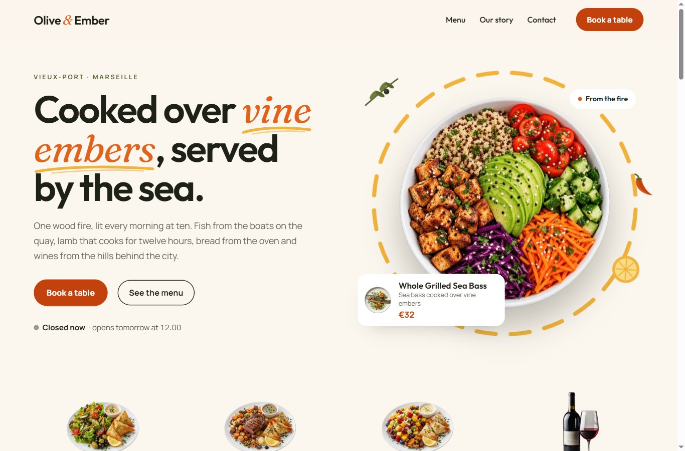

# Olive & Ember — restaurant website with a custom table reservation system

A WordPress site for a fictional Mediterranean restaurant in Marseille, built from scratch:
a **Full Site Editing block theme** and a **reservation plugin with its own availability engine**.
No page builder, no booking plugin, no ACF.

[**▶ Try the live demo in WordPress Playground**](https://playground.wordpress.net/?blueprint-url=https://raw.githubusercontent.com/mouradlhousni/restaurant-demo/master/blueprint.json) — the full site runs in your browser, including the booking flow and the admin. Nothing is hosted, nothing is stored.



<!-- GIF of the booking flow: docs/screenshots/booking-flow.gif -->

## What it shows

| Area | Highlights |
| --- | --- |
| **Plugin architecture** | Namespaced PSR-4 classes, one responsibility each; a pure-PHP availability engine with no WordPress dependency, covered by PHPUnit |
| **Availability logic** | Opening periods per weekday, slot interval, service duration, capacity in covers, party size, exceptional closures, minimum notice, booking window, site timezone, DST-safe |
| **REST API** | `GET oe/v1/availability`, `POST oe/v1/reservations` with nonce, honeypot, rate limiting and strict validation |
| **Concurrency** | No double booking: per-day named lock + `SELECT … FOR UPDATE` re-check inside a transaction (tested with 6 parallel requests) |
| **Emails** | HTML confirmation, request received, cancellation, restaurant notification; one-click cancellation link with a hashed token |
| **Admin** | `WP_List_Table` screen (filters, row and bulk actions, CSV export), a “Today’s service” view, Settings API screen |
| **Gutenberg** | 4 dynamic blocks: Menu Section, Reservation Form, Opening Hours, Restaurant Map |
| **Front end** | Block theme with `theme.json`, accessible multi-step booking form, allergen/diet filters, JSON-LD `Restaurant` |
| **Tooling** | WP-CLI seeding, phpcs (WordPress Coding Standards), PHPUnit, ESLint/Stylelint via `@wordpress/scripts` |
| **Safe demos** | Demo mode, WordPress Playground blueprint, static HTML export (see [Demo modes](#demo-modes-and-why)) |

## Features

### Menu
- `menu_item` post type: name, description (excerpt), price, photo (featured image), **Chef’s pick** badge.
- Taxonomies: `menu_section` (Starters, Mains, Desserts, Wines) with a **custom display order**, `menu_allergen` (EU list), `menu_diet` (vegetarian, vegan, gluten-free, dairy-free).
- Admin: “Dish details” meta box, photo/price/Chef’s pick columns, price sorting, section filter.

### Reservations
- Custom table `{prefix}oe_reservations`, created with `dbDelta` and upgraded automatically when the schema version changes.
- **Settings** (Reservations → Settings): weekly hours (`12:00-14:30, 19:00-22:30`), exceptional closures (dates or ranges), slot interval, service duration, capacity, largest party, minimum notice, booking window, auto-confirmation, restaurant details.
- **Booking form** in five steps — date → guests → time → details → confirmation — asking the availability API live. Closed days are disabled, times already full are shown but unavailable, errors are written next to the field and announced to screen readers.
- **Emails**: guest confirmation (or “request received” when bookings need manual confirmation), restaurant notification, cancellation confirmation.
- **Self-service cancellation**: the email link opens a summary page; the cancellation itself is a nonce-protected POST, so mail scanners that open links cannot cancel anything.
- **Admin**: status views with counts, date ranges (today, tomorrow, next 7 days, upcoming, past, custom), search, confirm / no-show / cancel (row and bulk, with guest emails), CSV export of the current filters, and a **Today’s service** timeline with occupancy per slot and a print stylesheet.

### Theme
- Block theme: warm cream / ember / olive palette, self-hosted fonts (Outfit for headings, Fraunces italic for highlighted words, Manrope for text), fluid type scale, spacing and shadows in `theme.json`; templates, header/footer parts and patterns. Design direction: [`docs/design-direction.html`](docs/design-direction.html).
- Pages: Home (hero with a cut-out plate and live “Open now” badge, menu sections, the kitchen, Chef’s picks, produce and suppliers, guest book carousel, booking call to action with today’s service timeline), Menu, Book a table, Contact (hours and map from the plugin settings), 404.
- Photos: drop them into `themes/olive-ember/assets/images/photos/` (slots listed in its README) and dish photos into `plugins/oe-reservations/assets/seed/`; until then the theme shows neutral placeholders and the seed generates illustrations.
- Light motion only, disabled with `prefers-reduced-motion`.

### Blocks (in the plugin)
| Block | Purpose |
| --- | --- |
| **Menu Section** | One section as a printed menu card (dotted price leaders) or photo cards; optional allergen/diet filter bar shared by every section on the page, mirrored in the URL (`?diet=vegan&allergen=nuts`) |
| **Reservation Form** | The booking flow; also renders the cancellation panel and, in the static export, a preview with a link to the live demo |
| **Opening Hours** | Full week, compact or “today’s service” timeline; the **Open now / Closed** badge is recomputed in the browser every minute, in the restaurant’s timezone |
| **Restaurant Map** | OpenStreetMap with self-hosted Leaflet, downloaded only when the map scrolls into view |

All four are dynamic (server-rendered), and WordPress loads their CSS and JS only on pages that contain them.

## Screenshots

| | |
| --- | --- |
|  |  |
|  |  |
|  |  |
|  | |

<p>
  
  
</p>

## How availability works

Everything lives in `AvailabilityService` (with `BookingRules`), plain PHP with no WordPress calls: “now”, the timezone and the existing reservations are passed in, which makes the logic deterministic and unit-testable.

1. **Day status.** A date is refused if the party size is outside `1…max_party`, if it is in the past or beyond the booking window, if it is an exceptional closure, or if the restaurant has no opening period that weekday.
2. **Slots.** Each opening period yields a start time every `slot_interval` minutes, **as long as a whole service fits before closing**: with lunch at 12:00–14:30 and 90-minute services, the slots are 12:00, 12:30 and 13:00.
3. **Occupancy.** A reservation occupies its covers from its start time for `service_duration` minutes. A party of *N* can take slot *T* if, at every moment of `[T, T + duration)`, the covers already seated plus *N* stay within `capacity`. Occupancy only changes when a reservation starts, so it is enough to check *T* itself and every reservation start inside the window. A 19:00 booking therefore also blocks 19:30 and 20:00, and a large 20:00 booking can make 19:00 unavailable.
4. **Notice.** Slots closer to now than `min_notice` are shown as “too soon”.
5. **Time zone.** Dates and times are always in the site timezone (`wp_timezone()`); slot times are built with wall-clock `setTime()`, so daylight-saving changes never shift a service.

**Booking without double booking.** `ReservationRepository::create()` takes a MySQL named lock for the day, opens a transaction, re-reads that day’s reservations with `SELECT … FOR UPDATE`, asks the engine again, and only then inserts. Two guests racing for the last table: one gets `201 Created`, the other `409 Conflict` and is sent back to the times with a fresh list.

The PHPUnit suite (`plugins/oe-reservations/tests`) covers slot generation, intervals, weekly and exceptional closures, past dates and the booking window, party limits, minimum notice, timezones, shared capacity, overlapping and off-grid reservations, precise slot checks, open/closed status and DST.

## Plugin architecture

```
plugins/oe-reservations/
├── oe-reservations.php          bootstrap, PSR-4 autoloader (no vendor folder needed at runtime)
├── includes/functions.php       public API for the theme: oe_is_demo_mode(), oe_setting(), oe_format_price()…
├── src/
│   ├── Plugin.php               wires the components
│   ├── Availability/            BookingRules, AvailabilityService (pure PHP, unit-tested)
│   ├── Reservations/            Installer (dbDelta), ReservationRepository (all SQL), BookingService, Cancellation
│   ├── Rest/                    AvailabilityController, ReservationsController, RateLimiter
│   ├── Email/Mailer.php         HTML emails
│   ├── Menu/                    PostTypes, MenuRepository (cached), Admin
│   ├── Settings/                Settings (defaults + rules), SettingsPage (Settings API)
│   ├── Admin/                   AdminMenu, ReservationsPage, ReservationsListTable
│   ├── Blocks/                  registration + one view class per block
│   ├── Frontend/                JsonLd, DemoBanner, StaticBuild
│   └── Cli/                     wp oe seed, seed data, procedural dish illustrations (GD)
├── blocks/                      block sources (block.json, editor JS, view JS, CSS)
├── build/blocks/                compiled blocks (committed, so the plugin installs without a build step)
└── tests/                       PHPUnit
```

**Security.** Every query goes through `$wpdb->prepare()` (identifiers are whitelisted), every output is escaped, inputs are sanitized and validated server-side, admin actions check a capability (`oe_capability()`, filterable) and a nonce. Cancellation tokens are 256-bit random values stored as an HMAC. The rate limiter keys on a salted hash of `REMOTE_ADDR` only (forwarded headers are spoofable; a filter is provided for trusted proxies).

**REST API**

```http
GET  /wp-json/oe/v1/availability?date=2026-10-09&guests=4
POST /wp-json/oe/v1/reservations     (X-WP-Nonce header)
     { "date": "2026-10-09", "time": "20:00", "guests": 4, "name": "…", "email": "…", "phone": "…", "notes": "…" }
```

| Status | Meaning |
| --- | --- |
| `201` | Booked (`200` with `"demo": true` in demo mode) |
| `400` | Validation errors, per field in `data.fields` |
| `403` | Missing or expired nonce |
| `409` | Slot no longer available (reason in `data.reason`) |
| `429` | Rate limited (5 bookings / 15 min, 120 availability checks / 10 min per client) |

## Installation

Requirements: PHP 8.1+, Node 20+, Composer, and Docker for `wp-env`.

```bash
git clone https://github.com/mouradlhousni/restaurant-demo.git olive-ember
cd olive-ember
composer install
npm install

npx wp-env start                         # WordPress at http://localhost:8888 (admin / password)
npx wp-env run cli wp oe seed            # settings, 30 dishes, pages, 40 reservations
```

`wp oe seed` can be run again at any time; `--images=<n>` limits generated illustrations (dishes with a photo in `plugins/oe-reservations/assets/seed/` always use it), `--reservations=<n>` changes the number of bookings.

**Without Docker** (e.g. Laragon, LocalWP, MAMP): install WordPress, link or copy `themes/olive-ember` and `plugins/oe-reservations` into `wp-content`, activate the plugin, then run `wp oe seed`. The seed activates the theme.

### Development commands

| Command | |
| --- | --- |
| `npm run build` | Build the blocks and minify the theme assets |
| `npm run start` | Watch and rebuild the blocks |
| `npm run lint` | phpcs + ESLint + Stylelint |
| `composer test` | PHPUnit |
| `npm run vendor` | Copy fonts and Leaflet from `node_modules` |
| `npm run export:static` | Build the static showcase in `dist/` |

## Demo modes (and why)

This is a portfolio piece. A live WordPress with public forms is an attack surface and a spam magnet, so the project is **never shown as a dynamic site on a public server**. Instead:

1. **Static showcase** — the site exported to plain HTML (`bin/export-static.sh`) and deployable to Cloudflare Pages, Netlify or GitHub Pages. No PHP, no database, no REST API. The menu filters and the Open now badge still work (pure JavaScript with the schedule embedded in the page); the booking form shows a preview and a link to the live demo.
2. **WordPress Playground** — `blueprint.json` installs the theme and plugin from this repository into a WordPress that runs **entirely in the visitor’s browser** (WebAssembly), seeds it and logs in as admin. Every feature can be tried, including the admin screens, and nothing is hosted anywhere.

Both run with **demo mode** on (`OE_DEMO_MODE`, read through `oe_is_demo_mode()`): forms validate normally, the booking flow runs to the end against the real availability engine, but nothing is written and no email is sent; a fictitious confirmation is shown instead, and cancellation links are disabled. Demo mode is a clean short-circuit — with the constant set to `false`, the real code paths (inserts, emails, cancellations) run.

```php
// wp-config.php
define( 'OE_DEMO_MODE', true );    // forms validate but store and send nothing
define( 'OE_STATIC_BUILD', false ); // set by bin/export-static.sh during the export
```

### Static export

```bash
WP_CLI="wp --path=/path/to/wordpress" PUBLIC_URL="https://olive-ember.pages.dev" bash bin/export-static.sh
npx serve dist
```

`PUBLIC_URL` is optional: it turns canonical links into absolute URLs of the deployed site (they are removed when it is not set).

The script turns `OE_STATIC_BUILD` on (and restores it afterwards), mirrors the site with `wget` (or a dependency-free Node crawler, or a folder exported by the Simply Static plugin with `--from`), makes every URL relative, removes `wp-login.php`, `xmlrpc.php`, `/wp-json/` and admin links, writes a `_headers` file (security and cache headers), and fails if anything dynamic is left.

## Quality

- **phpcs** (WordPress Coding Standards + PHPCompatibility): no errors or warnings. The `PrefixAllGlobals` sniff is disabled because the project convention is the short `oe_` prefix, which WPCS rejects as shorter than 4 characters.
- **PHPUnit**: 24 tests on the availability logic.
- **Lighthouse** (mobile, simulated slow 4G) on Home, Menu, Book a table and Contact:

  | Build | Performance | Accessibility | Best practices | SEO |
  | --- | --- | --- | --- | --- |
  | Static export (`npx serve dist`, compressed) | 93–97 | 100 | 100 | 100 |
  | WordPress on local Apache (no gzip, no cache headers) | 88–92 | 100 | 100 | 100 |

- **Playground**: `wp oe seed --images=8` runs in about 22 s inside WordPress Playground (PHP WebAssembly + SQLite), measured with `@wp-playground/cli`.
- No PHP notice with `WP_DEBUG`, no console error.

## License

GPL-2.0-or-later. Fonts: SIL Open Font License (Outfit, Fraunces, Manrope). Leaflet: BSD-2-Clause. Map data © OpenStreetMap contributors. Olive & Ember, its staff and its guests are fictional.
